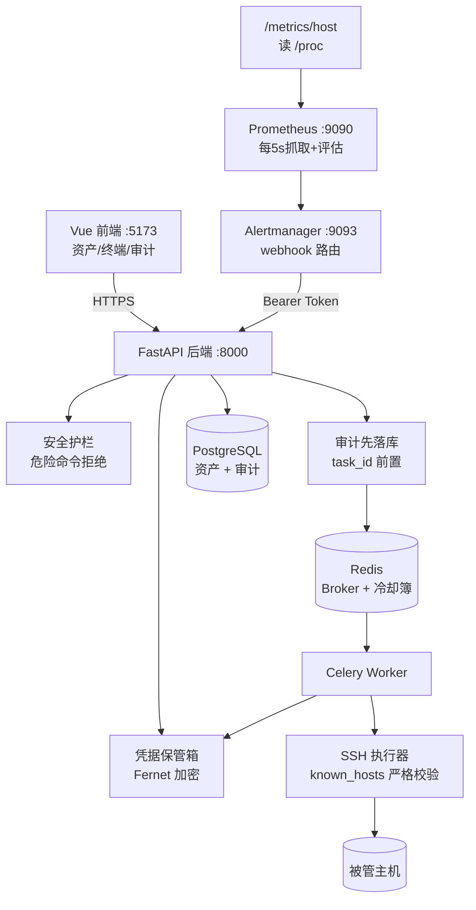

# OpsPilot — 自动化运维自愈平台

一个能"自己发现故障、自己动手修、修完留痕"的运维平台。当前版本已在本地跑通**真实 Prometheus → Alertmanager → 自动 SSH 自愈**的完整闭环。

> 阅读约定：先用大白话讲清楚它像什么、为什么这么设计，再给出术语名。重点是原理与设计取舍，不只是代码能跑。

## 一句话理解

把平台想象成医院急诊室：Prometheus 是每 5 秒量一次体温的监护仪；Alertmanager 是决定"通知谁、多久提醒一次"的护士站；后端 Webhook 是分诊台，核对病人是否纳管、该用哪张处方；安全护栏是药房审核员，禁止开出`rm -rf /`这种致命处方；Celery Worker 是出诊医生，真正 SSH 到机器上执行并把结果写回病历（审计表）；Redis 冷却簿记着"这台病人刚抢救过，别重复折腾"。

## 核心能力

- 资产台账：录入纳管主机，SSH 密码以 Fernet 密文保存，不回显明文。
- 手动执行：页面下发 Shell 命令，异步走 SSH，实时轮询结果。
- 安全护栏：在命令进入执行队列前拦掉删根目录、格式化、关机、fork bomb、下载即执行等危险动作；被拦也写 `REJECTED` 审计。
- 告警自愈：Prometheus 抓真实主机指标，触发规则后经 Alertmanager 推 Webhook，自动匹配剧本、去重、派发、回写终态。
- 审计闭环：任务号前置生成，先落库再派发，杜绝"活干了没记录"。

## 快速开始（本地 WSL）

### 前置条件

- Docker（Postgres、Redis、Prometheus、Alertmanager 用容器跑）
- Python 3.12 + venv、Node 20+
- 目标主机可通过 SSH 访问；若开了严格主机校验，先把指纹登记到 `~/.ssh/known_hosts`

### 1. 起依赖容器

```bash
cd deploy
docker compose -f docker-compose.dev.yml up -d
```

### 2. 配置后端

```bash
cd backend
python -m venv .venv && source .venv/bin/activate
pip install -r requirements.txt
cp ../.env.example .env
```

在 `backend/.env` 里至少配好两样：

- `ALERT_WEBHOOK_TOKEN=<高熵随机串>` —— 留空则 Webhook 按 fail-closed 返回 503
- `SSH_CREDENTIAL_KEY=<Fernet 密钥>` —— 生成方式见 `.env.example`；留空则拒绝保存密码

数据库迁移：

```bash
alembic upgrade head
```

### 3. 同步 Token 给 Alertmanager 并起服务

```bash
cd ..
bash scripts/sync-alertmanager-token.sh
bash scripts/start-dev.sh
```

默认 HTTP 模式访问 `http://localhost:5173`。需要 HTTPS 时用 `OPSPILOT_HTTPS=1 bash scripts/start-dev.sh`：首次会自动建本地私有 CA 并由它签发后端证书（`scripts/generate-dev-ca.sh`）。服务端之间（Prometheus/Alertmanager 到后端）用 `ca.crt` 做**真正校验**，不再跳过；浏览器仍会提示不受信任，把 `deploy/certs/ca.crt` 导入系统/浏览器信任根即可消除。脚本会记住上次模式，重复执行是幂等的。

### 4. 验证自愈闭环

打开页面应能看到指标、资产、终端、审计四块。触发一次真实告警：

```bash
# Prometheus 已配每 5 秒抓 /api/v1/metrics/host，规则 CpuUsageHigh 阈值为 >0（演示用）
curl -s http://localhost:9090/api/v1/alerts
curl -s http://localhost:9093/api/v2/alerts
```

一两个评估周期后，审计表会出现 `trigger_source=ALERT_WEBHOOK`、`status=SUCCESS` 的记录，stdout 是远程主机 `uptime && free -m && df -h` 的真实输出。

## 运行测试

```bash
cd backend
python -m pytest tests/ -q      # 74 个单测，无外部依赖
```

覆盖：命令护栏（含各类绕过变形）、凭据加密往返与篡改检测、Webhook 鉴权 401/503 语义、冷却去重互斥与降级、审计"先落库再派发"编排。CI 里同时跑前端 `npm run build`。

## 整体架构



## 几个关键设计取舍

- **先写病历再派医生**：审计记录先提交，任务号由 API 生成并随派发传给 Worker，两边共用同一号码，从根上消除 worker 抢跑导致的审计丢失。
- **密码装保险箱寄送**：数据库存密文、队列传密文信封，只有 Worker 连接前才解密；钥匙没配就拒绝，不退回明文。
- **只认见过的脸**：SSH 默认 `known_hosts` + `RejectPolicy`，而非首次见面就信任的 `AutoAddPolicy`。
- **门禁坏了关门，优化坏了当它不存在**：Token 没配 → 503 拒绝；Redis 挂了 → 去重降级为不去重，不阻塞自愈。
- **归一化只用于判断**：命令去引号、转小写后的结果绝不拿去执行，下发的永远是原始字符串。
- **护栏不是沙箱**：它挡手滑和常见绕过，真正的隔离靠受限 SSH 账号和 sudoers 白名单。

## 当前状态与剩余工作

已跑通：审计闭环、REJECTED 留痕、前端视觉、SSH 指纹校验、凭据加密、HTTPS、真实 Prometheus/Alertmanager 自愈闭环、单测与 CI。

尚未完成（按优先级）：

- **P0 已完成**：代码提交、单测与 CI、本文档。
- **P1 生产化（已完成）**：本地私有 CA 签发证书，服务端之间去掉 `insecure_skip_verify` 改真正校验；Token 走 Docker Secret；生产环境启动即拒绝不安全开关（配置校验 + 单测）；统一 `.env.example` 与 compose 账号密码；Prometheus/Alertmanager 挂数据卷；告警规则分成演示版 `rules.yml` 与生产模板 `rules.prod.yml.example`。
  - 仍需在真实部署时做：把本地 CA 换成可信 CA 证书、按基线调整生产规则阈值、导入 CA 根证书到浏览器消除告警。
- **P2 功能补全（已完成主体）**：
  - 指标接口新增磁盘使用率、SSH 服务存活；`DiskUsageHigh`/`ServiceDown` 规则已激活（3 条规则共存，后两条用真实阈值、正常不触发）。
  - 资产状态回写：自愈成功 → `online`，连不上 → `unreachable`，命令本身失败保持原状态（不误判为宕机）。
  - 资产编辑/删除 API + 前端接入；密码三态（不传=保持、空串=清空、非空=加密替换），删除资产不丢审计。
  - 审计统计 API（成功率剔除 REJECTED）+ 按任务号详情接口，前端指标卡改用后端口径、审计抽屉打开时拉全文。
  - 尚未做：任务超时/重试/回滚、通知渠道（钉钉/邮件）。
- **P3 运维增强**：Dockerfile 与生产编排；平台自监控（队列积压、失败率、API 延迟）；启动脚本残留进程清理。

> 注：身份认证 / 登录 / RBAC 按项目约定不做。

## 目录结构

```
backend/     FastAPI + Celery + SQLAlchemy + Alembic 迁移 + pytest
frontend/    Vue 3 + Vite + Element Plus
deploy/      本地 compose、Prometheus 规则、Alertmanager 配置、证书
scripts/     一键启动、证书生成、Token 同步
docs/        预留文档目录
lab/         预留实验目录
```

## 安全提醒

本地仍用了私有 CA（非可信 CA）、演示阈值 `>0` 等"图省事"设定，**仅限开发机**。服务端之间的证书校验已是真正的校验（非跳过）。上生产前请按 `rules.prod.yml.example` 调整阈值，并把本地 CA 换成可信 CA 证书。
